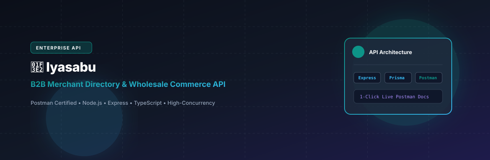
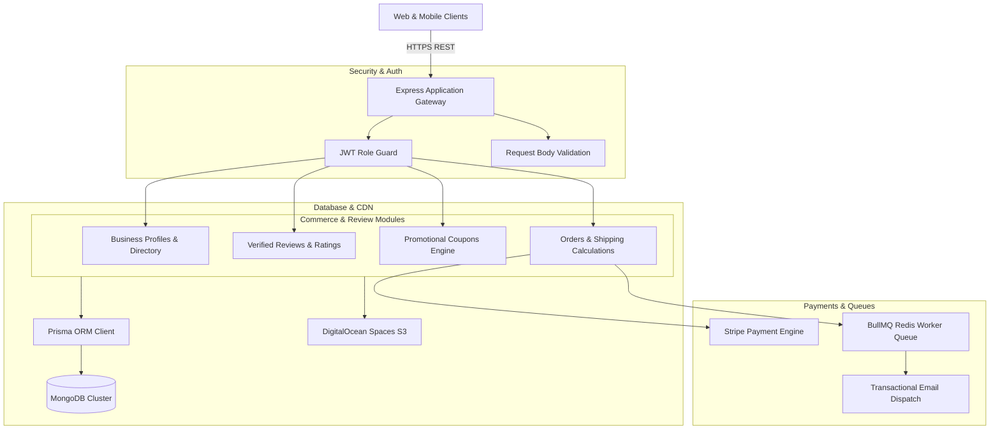

# Iyasabu Backend - Business Reviews & Commerce API

<p align="center">
  
</p>

<p align="center">
  <a href="https://nodejs.org"></a>
  <a href="https://expressjs.com"></a>
  <a href="https://www.typescriptlang.org"></a>
  <a href="https://www.prisma.io"></a>
  <a href="https://www.mongodb.com"></a>
  <a href="https://bullmq.io"></a>
  <a href="https://stripe.com"></a>
  <a href="LICENSE"></a>
</p>

---

## 📖 Overview

**iyasabu_backend** is a verified business review and local enterprise commerce API built with Node.js, Express.js, TypeScript, and Prisma ORM with MongoDB. The system empowers businesses to establish verified organizational profiles, collect customer reviews, run coupon campaigns, process e-commerce orders via Stripe, and run asynchronous email queues with BullMQ.

---

## ⚡ Key Features

- 🏢 **Verified Business Profiles:** Enterprise registration with location data, business categories, and operating hours.
- ⭐ **Verified Review Engine:** Two-sided customer review submissions, photo attachments, and merchant reply workflows.
- 🎟️ **Coupon & Promotion Management:** Dynamic discount coupons with usage thresholds and expiry timestamps.
- 📦 **E-Commerce Order Fulfillment:** Integrated checkout supporting item variants, destination shipping calculations, and Stripe payments.
- ⚡ **BullMQ Background Workers:** High-throughput email worker processing transactional messages and review notifications via Redis.
- ☁️ **DigitalOcean Spaces Integration:** S3-compatible cloud media hosting for business brand assets and review photos.

---

## 🏗️ System Architecture



---

## 📂 Directory Structure

```text
.
├── src/
│   ├── app/
│   ├── components/
│   └── ...
├── assets/
│   └── banner.svg
├── .env.example
├── .gitignore
├── package.json
├── README.md
└── LICENSE
```

---

## 🛠️ Tech Stack & Dependencies

| Layer / Library | Version | Description |
|---|---|---|
| **Express.js** | `v4.21` | HTTP routing and middleware framework |
| **TypeScript** | `v5.x` | Type safety across business logic |
| **Prisma ORM** | `v6.x` | MongoDB modeling and query construction |
| **BullMQ** | `v5.x` | Asynchronous job queues and email processing |
| **Stripe SDK** | `v17.x` | Payment gateway integration |
| **AWS SDK (S3 Client)** | `v3.x` | DigitalOcean Spaces file storage integration |

---

## ⚙️ Environment Variables

Create a `.env` file in the project root based on the provided sample:

```bash
cp .env.example .env
```

Configurable variables:

```env
PORT=8000
NODE_ENV=development
DATABASE_URL=mongodb+srv://<username>:<password>@cluster.mongodb.net/iyasabu?retryWrites=true&w=majority

JWT_SECRET=your_jwt_secret
EXPIRES_IN=15d

# Redis / BullMQ
REDIS_HOST=127.0.0.1
REDIS_PORT=6379

# Stripe
STRIPE_PK=pk_test_your_stripe_public_key
STRIPE_SK=sk_test_your_stripe_secret_key
STRIPE_WEBHOOK_SECRET=whsec_your_stripe_webhook_secret

# DigitalOcean Spaces
DO_SPACE_ENDPOINT=https://nyc3.digitaloceanspaces.com
DO_SPACE_ACCESS_KEY=your_access_key
DO_SPACE_SECRET_KEY=your_secret_key
DO_SPACE_BUCKET=iyasabu-storage
```

---

## 🚀 Getting Started

### Prerequisites

- Node.js (v20.x or higher recommended)
- Package Manager (`npm`, `yarn`, or `pnpm`)

### Installation

```bash
# Clone repository
git clone https://github.com/shahjalal-labs/iyasabu_backend.git
cd iyasabu_backend

# Install dependencies
npm install
```

### Running Locally

```bash
# Start development server
npm run dev
# or for backend services
npm run start:dev
```

### Building for Production

```bash
# Create production build
npm run build

# Start production server
npm start
```

---

## 📄 License

This project is licensed under the [ISC License](LICENSE).
